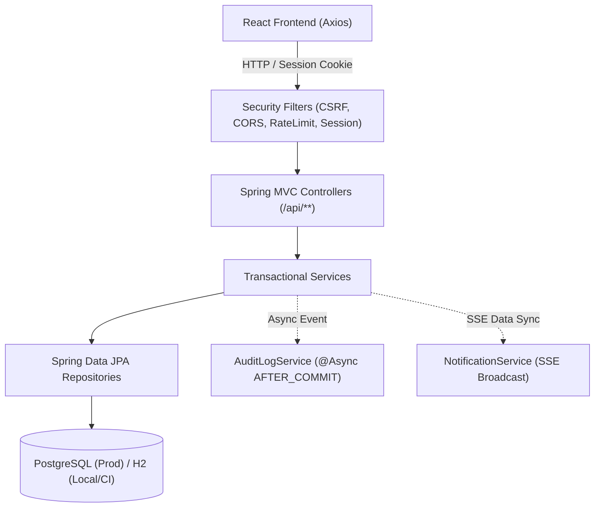

# 🏛️ 현행 시스템 아키텍처 진단 보고서 (architecture-current.md)

> **진단 일시**: 2026-10-12  
> **진단 범위**: `internal-management-system` 백엔드, 프론트엔드, DB, 인프라 및 보안  
> **진단 원칙**: 소스코드/설정 직접 판독 기준 (추측 배제, 민감정보 마스킹)

---

## 1. 기술 스택 현황

| 계층 | 기술 스택 | 버전 / 세부 사양 | 비고 |
| :--- | :--- | :--- | :--- |
| **Backend Core** | Java, Spring Boot | Java 17, Spring Boot 3.2.12 | Maven (`backend/pom.xml`) |
| **Security & Auth** | Spring Security, Spring Session | Spring Security 6.2, Spring Session JDBC | 세션 쿠키: `QMS_SESSION_V2`, SameSite/Secure |
| **Persistence** | Spring Data JPA, Hibernate, Flyway | Hibernate 6.4, Flyway 9.22 | 마이그레이션 134건 (`V1` ~ `V130`) |
| **Database** | PostgreSQL, H2 | PostgreSQL 15+ (운영), H2 2.2 (로컬/CI) | H2 PostgreSQL 호환모드 적용 |
| **Utility / Lib** | Apache POI, iText, Bucket4j, Caffeine | POI 5.2.3, iText 5.5.13.3, Bucket4j 7.6.0 | 엑셀/PDF 생성, Rate Limiting, 캐시 |
| **Frontend Core** | React, Vite | React 18.2.0, Vite 4.3.9 | SPA 아키텍처 (`frontend/package.json`) |
| **UI Framework** | Material UI, Emotion | MUI 7.3.9, Emotion 11.14 | 대시보드, 폼, 다이얼로그 |
| **Data Grid** | AG Grid | AG Grid Community 35.1.0 | 그리드 렌더링 및 가상화 |
| **HTTP Client** | Axios | Axios 1.13.5 | `withCredentials: true` (쿠키 기반 세션 인증) |
| **CI / CD** | GitHub Actions | Ubuntu Latest, Temurin JDK 17, Node 20 | push: `main` 트리거 시 HF Spaces 강제 배포 |

---

## 2. 모듈 및 데이터 흐름 구조

### 2.1 Backend 레이어 흐름

### 2.2 현재 구현된 주요 업무 도메인
1. **제품 관리 (`Product`)**: 단품/세트, 바코드, 포장재, 규제 성분 스캔 (`RegulatoryIngredient`), 제품 서류 및 주의사항 관리.
2. **제조사 관리 (`Manufacturer`)**: 제조사 기본정보, 연락처, 평가 이력, 토큰 기반 외부 서류 요청/수신 (`VendorUploadController`).
3. **클레임 관리 (`Claim`)**: 0~5단계 품질사고/클레임 접수 및 조사, 제조사 공유, 사진/원인/대책 기록.
4. **입고 품질검사 (`WmsInbound`)**: 1~5단계 입고 검사, 합부 판정, 시험 성적서(COA) 관리.
5. **감리 및 심사 (`ProductionAudit`, `ManufacturerAudit`)**: 생산 감리 체크리스트, 제조사 현장 실사 및 등급 평가.
6. **전자결재 (`ApprovalDocument`, `ApprovalService`)**: 결재선 템플릿, 순차/병렬 승인, 합의, 반려, 회수, 결재 사후 연동 훅.
7. **감사로그 및 이력 (`AuditLog`, `AccessLog`)**: 엔티티 변경 이력(비동기 저장), 화면 열람 로그, 6개월 아카이빙.
8. **동적 화면/메뉴 관리 (`dynamic_screens`, `menu_items`)**: 역할(Role)별 메뉴 트리, 화면 권한 동적 제어.

---

## 3. 인프라 및 배포 파이프라인

- **배포 설정**: `.github/workflows/deploy.yml`
  - 브랜치: `main` 푸시 시 자동 실행
  - 단계 1: Backend CI 테스트 (`./mvnw test -Dspring.profiles.active=ci`)
  - 단계 2: Frontend 빌드 (`npm run build`)
  - 단계 3: Hugging Face Spaces 원격 저장소로 `git push --force` 배포
- **배포 주의사항**: `main` 브랜치에 직접 푸시할 경우 즉시 운영 환경이 갱신되므로 승인 없는 Git 커밋 및 푸시는 절대 금지되어 있음.
