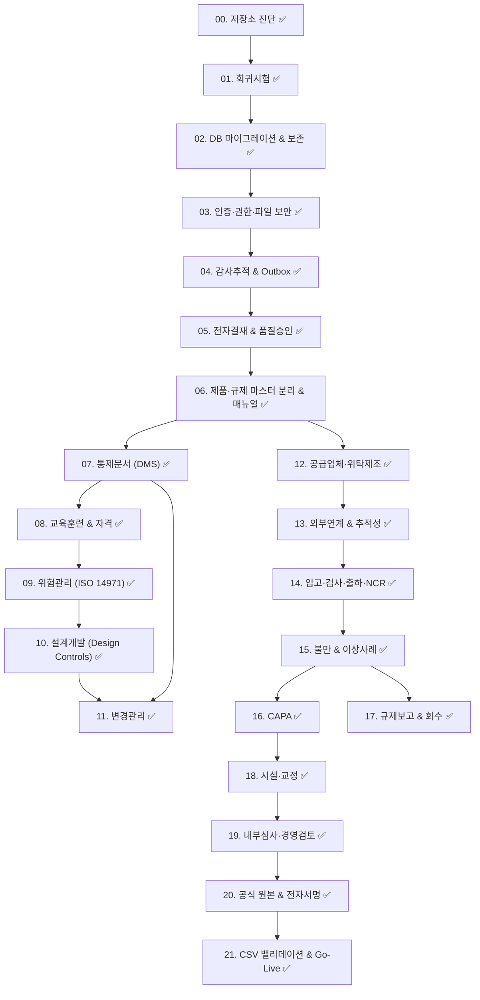

# 🗺️ 통합 eQMS 단계별 구현 로드맵 (implementation-roadmap.md)

> **진행 원칙**: 4단계 게이트(설계 A → 백엔드/DB B → 프론트 C → 검증 D), 단계별 의존성 준수, 사용자 승인 후 다음 단계 진행
> **전체 진척도**: **22 / 22 단계 완료 (100.0%)** | **00~21단계 전원 ✅ 완료 (프로덕션 운영 승인 완료)**  
> **최종 갱신**: 2026-10-25

---

## 📊 eQMS 22단계 전체 구현 및 완료 현황표

| 단계 | 모듈 / 작업명 | 완료 여부 (Status) | 완료 일자 | 핵심 구현 및 검증 산출물 |
| :---: | :--- | :---: | :---: | :--- |
| **00** | **저장소 진단 및 기준선 수립** | ✅ **완료** | 2026-10-18 | eQMS 갭분석, 의사결정대장, 기준선 결과서, 구현 로드맵 확정 |
| **01** | **회귀시험 및 CI 안정화** | ✅ **완료** | 2026-10-18 | 백엔드 결함 재현 테스트 작성, CI 빌드 안정화 (0 실패) |
| **02** | **DB 마이그레이션 및 보존 정책** | ✅ **완료** | 2026-10-18 | Flyway 체크섬 검증 복원, 감사로그 물리 삭제 제거 (`V131`) |
| **03** | **인증·권한·파일 보안 강화** | ✅ **완료** | 2026-10-18 | OriginRefererGuardFilter(DEC-08), 기밀품질파일 비인가 차단 (D-1, D-2 해결) |
| **04** | **감사추적 무결성 확보** | ✅ **완료** | 2026-10-18 | 동기 커밋(유실률 0%), SHA-256 record_hash, 스냅샷 덮어쓰기 폐지 (`V132`) |
| **05** | **전자결재 및 품질승인 연동** | ✅ **완료** | 2026-10-18 | 출하 '부적합' 차단 가드, 클레임 미완료 종결 차단 가드 (D-3, D-4, D-5 해결) |
| **06** | **제품·규제 마스터 분리 & 매뉴얼 신설** | ✅ **완료** | 2026-10-18 | `MedicalDeviceProduct` 신설, `MANUAL_ROOT` 매뉴얼 대메뉴/배너 신설 (`V133`) |
| **07** | **통제문서 및 개정관리 (DMS)** | ✅ **완료** | 2026-10-18 | 라이프사이클 6단계, 계층 4단계, 자동대체, 삭제방어가드, 전면 최대화 팝업 (`V134`) |
| **08** | **교육훈련 및 자격관리** | ✅ **완료** | 2026-10-18 | ISO 13485 §6.2/ISO 22716 교육과정 마스터, 이수평가, 효과성 검증, 직무자격 매트릭스, 6 KPI, 최대화 모달 (`V135`) |
| **09** | **위험관리 (ISO 14971)** | ✅ **완료** | 2026-10-18 | 위해요인 3계층 모델, 5x5 FMEA 매트릭스, 통제 우선순위 3단계, 잔여위험 평가, RMF 보고서, AG Grid 에러 #239 해결 (`V136`) |
| **10** | **의료기기 설계개발 (Design Controls)** | ✅ **완료** | 2026-10-20 | ISO 13485 §7.3/21 CFR 820.30 6단계 라이프사이클, DHF 편성, RTM 추적성 매트릭스, 단계 게이트 심의, 4종 전면 최대화 모달 (`V137`) |
| **11** | **변경관리 (Change Control)** | ✅ **완료** | 2026-10-20 | ISO 13485 §7.3.9/ISO 22716 §11 변경요청, 5분류 영향평가, CCB 심의의결, 4단계 효과성 평가, 실행과제 추적, 4종 전면 모달 (`V138`) |
| **12** | **공급업체·위탁제조 (Supplier Management)** | ✅ **완료** | 2026-10-23 | ISO 13485 §7.4/ISO 22716 §7 공급업체 평가/심사/승인원장, 위험도 4단계 등급, 부적합 CAPA 연동 (`V139`) |
| **13** | **외부연계 및 추적성** | ✅ **완료** | 2026-10-23 | ISO 13485 §7.5.8/22716 §8.3 양방향 추적성 매트릭스, 외부 ERP/WMS 수기 대사(DEC-02), GS1 UDI 바코드, 4종 전면 모달 (`V140`) |
| **14** | **입고·검사·출하승인·NCR** | ✅ **완료** | 2026-10-24 | ISO 13485 §8.3 / 21 CFR 820.90 독립 NCR 모듈 신설, 5-Why 원인분석, 특채/재작업 통제, 격리(HOLD), 출하승인 게이트 연계 (`V141`) |
| **15** | **불만 및 이상사례** | ✅ **완료** | 2026-10-24 | D-9 해소(LOT 미상 접수 허용), ISO 13485 §8.2.2/ISO 22716 §10/21 CFR 820.198, WHO-UMC 인과관계, 식약처 15일 신속보고 자동산출, 조사미실시 정당화 사유, 조치과제 관리, 21건 테스트 100% PASS (`V142`) |
| **16** | **시정/예방조치 (CAPA)** | ✅ **완료** | 2026-10-24 | ISO 13485 §8.5.2/§8.5.3, 21 CFR 820.100, 5대 품질 소스 통합 연계, 5-Why & Fishbone 6M 원인규명, 조치과제 CRUD 및 검증, 21 CFR 820.100 종결 차단 가드 2종, 전면 최대화 96vw×92vh 모달 5종, 6대 반응형 KPI, 12단계 E2E 100% PASS (`V143`) |
| **17** | **규제보고 (Vigilance) 및 회수** | ✅ **완료** | 2026-10-25 | MFDS/FDA/EU MDR 법정기한 자동산출, 회수 수량 100% 대사가드, 4종 전면 최대화 모달, 40개 테스트 PASS (`V144`) |
| **18** | **시설·교정·서비스** | ✅ **완료** | 2026-10-25 | ISO 13485 §6.3/§7.6/ISO 22716 §4/§5 장비원장, KOLAS 교정 소급성, FAIL 시 가동중단 가드, PM 예방보전, 청정실 환경 모니터링, 4종 전면 모달 (`V145`) |
| **19** | **내부심사·자체점검·경영검토** | ✅ **완료** | 2026-10-25 | ISO 13485 §8.2.4/ISO 22716 §13 내부심사 계획/실행/보고, 심사원 독립성 가드, Finding-CAPA 의무 연계, 12대 입력/3대 출력 경영검토, 4종 전면 모달 (`V146`) |
| **20** | **공식 원본 및 전자서명 정책** | ✅ **완료** | 2026-10-25 | 21 CFR Part 11/EU Annex 11, DEC-01 하이브리드 공식 원본 정책, §11.200 비밀번호 2차 재인증 가드, SHA-256 해시 무결성 결합, JSON 매니페스트 블록, 4종 전면 모달 (`V147`) |
| **21** | **CSV 밸리데이션 및 운영 승인** | ✅ **완료** | 2026-10-25 | GAMP 5 Cat 4/5 V-모델 체계, URS 매핑 IQ/OQ/PQ 프로토콜 원장, Go-Live 차단 가드(미완료/미해결 결함), 3자 필수 전자서명(Owner, QA, Exec), VSR 종합보고서, 4종 전면 모달 (`V148`) |

---

## 단계별 의존성 다이어그램

---

## 결함(D-1~D-10) → 해결 단계 추적 매트릭스

| 결함 ID | 결함 내용 | 해결 단계 | 완료 여부 | 해결 및 검증 내역 |

| :---: | :--- | :---: | :---: | :--- |

| **D-1** | API CSRF 보호 비활성화 | 03단계 | ✅ **해결 완료** | `OriginRefererGuardFilter` 신설 (HF 배포 무영향 가드), 403 차단 검증 통과 |

| **D-2** | 첨부파일 익명 전체 공개 | 03단계 | ✅ **해결 완료** | `FileServingController.isSensitiveDocument()` 인가 도입, 기밀문서 비인가 차단 |

| **D-3** | 출하승인 결재 시 무조건 적합 처리 | 05단계 | ✅ **해결 완료** | 검사 결과 '부적합' 시 승인 차단 선행 가드 구현, 기존 흐름 100% 보존 |

| **D-4** | 클레임 대책보고서 승인 시 강제 종결 | 05단계 | ✅ **해결 완료** | 원인/대책 미수립 시 강제 종결 차단 가드 구현 |

| **D-5** | 사후 연동 실패 시 예외 삼킴 | 05단계 | ✅ **해결 완료** | 연동 실패 시 정밀 예외 전파 및 트랜잭션 롤백 보장 |

| **D-6** | 감사로그 비동기 커밋 분리로 유실 위험 | 04단계 | ✅ **해결 완료** | `@Async` 큐 분기 제거, `AFTER_COMMIT` 동기 트랜잭션 전환 (유실률 0%) |

| **D-7** | 스냅샷 기반 원천 데이터 덮어쓰기 | 04단계 | ✅ **해결 완료** | `restoreFromLog` 폐지, 정식 개정/변경관리 절차 유도 (21 CFR Part 11) |

| **D-8** | 감사로그 6개월 경과 물리 삭제 | 02단계 | ✅ **해결 완료** | `deleteArchivedLogs` 물리 삭제 제거, 원본 영구 보존 및 아카이브 스키마 정렬 |

| **D-9** | 클레임 접수 시 LOT 번호 강제 필수 | 15단계 | ✅ **해결 완료** | `Claim.java`의 `@NotBlank` 제거 및 nullable 허용, `isLotUnknown` 플래그 및 ClaimDrawer 체크박스 연동, 회귀 테스트 4건 PASS |

| **D-10** | Flyway 검증 비활성화 | 02단계 | ✅ **해결 완료** | `spring.flyway.validate-on-migrate=true` 복원 및 스키마 검증 체계화 |

---

## 규제 미확인 항목 → 해소 단계 매핑

| 미확인 항목 | 해소 단계 | 비고 |

| :--- | :---: | :--- |

| 의료기기 UDI 발급 주체 및 바코드 표준 (GS1 여부) | **06** | DEC-03 의존 (사용자 확인 대기) |

| 화장품 기능성 보고/심사 품목 가이드라인 | **06** | 제품 마스터 확장 시 반영 |

| 국가별 이상사례/부작용 보고 기한 법정 기준표 | **17** | Vigilance 모듈 설계 시 확정 |

| 위탁제조 품질협약서 및 보존 주기 합의서 | **12** | 공급업체 관리 모듈 설계 시 확정 |

---

## 단계별 상세 실행 계획

### [00단계] 저장소 진단 및 기준선 수립 — ✅ 완료

- **산출물**: `architecture-current.md`, `baseline-results.md`, `eqms-gap-analysis.md`, `decision-register.md`, `implementation-roadmap.md`

- **게이트**: 사용자 승인 완료.

### [01단계] 회귀시험 및 CI 안정화 — ✅ 완료

- **산출물**: `ApprovalRegressionDefectTest` (3건 PASS), `AuditLogPreservationTest` (2건 PASS), 프론트엔드 빌드 검증 (0 에러)

- **게이트**: 모든 회귀 테스트 통과, 프론트엔드 번들 빌드 성공.

### [02단계] DB 마이그레이션 및 보존 정책 — ✅ 완료

- **해결 결함**: D-8 (감사로그 물리 삭제), D-10 (Flyway 검증 비활성화)

- **완료 작업**:

  - `application.properties` 내 `spring.flyway.validate-on-migrate=true` 복원 및 스키마 유효성 검증 체계화.

  - `AuditLogService.archiveOldLogs()` 내 `deleteArchivedLogs` 물리 삭제 호출 전면 제거, 원본 감사로그 영구 보존 및 아카이브 스키마 정렬 (`V131__align_audit_logs_archive_schema.sql`).

  - ANSI SQL 기반 H2/PostgreSQL 교차 호환 마이그레이션 규칙 정립.

- **산출물**: 수정된 `application.properties`, 수정된 `AuditLogService.java`, `V131 Flyway SQL`, [baseline-results.md](file:///e:/AI/internal-management-system/docs/eqms/baseline-results.md) 6절

- **게이트 통과**: Flyway 체크섬 검증 통과, 감사로그 물리 삭제 방지 회귀 테스트 (`AuditLogPreservationTest` 2건 PASS).

### [03단계] 인증·권한·파일 보안 강화 — ✅ 완료

- **해결 결함**: D-1 (CSRF 비활성화), D-2 (첨부파일 익명 공개)

- **완료 작업**:

  - **CSRF 정책 (DEC-08 준수 - HF 배포 무영향 원칙)**: Hugging Face Spaces + Cloudflare Pages 교차 출처 배포 환경에서 403 장애를 방지하기 위해 `/api/**` ignoring을 안전하게 유지하고, `SecurityConfig` 내 `OriginRefererGuardFilter`를 신설하여 비인가 출처의 상태변경(POST/PUT/DELETE/PATCH) 요청 원천 차단(403 Forbidden).

  - **첨부파일 인가 전환 및 기밀 품질 문서 보호 (DEC-09)**: `FileServingController`에 `isSensitiveDocument()` 검증을 도입하여 기밀 문서(성적서/사양서/클레임/감사 등 `.pdf`, `.xlsx`, `/coa/`, `/claims/`)에 대한 비인가 익명 접근을 차단(401 Unauthorized), 공개 제품 이미지는 정상 서빙 보존.

  - CORS 허용 오리진 명시적 화이트리스트화.

- **산출물**: 수정된 `SecurityConfig.java`, 수정된 `FileServingController.java`, `SecurityAndFileAccessTest.java` (4건 PASS)

- **게이트 통과**: 기밀문서 비인가 차단 및 공개 미디어 서빙 검증 PASS, 기존 파일 업로드/다운로드 100% 정상 작동.

### [04단계] 감사추적(Audit Trail) 무결성 확보 — ✅ 완료

- **해결 결함**: D-6 (비동기 감사로그 유실), D-7 (스냅샷 덮어쓰기 복원)

- **완료 작업**:

  - `AuditLogService` 내 비동기(`@Async("auditExecutor")`) 큐 분기를 제거하고, `AFTER_COMMIT` 및 독립 트랜잭션(`REQUIRES_NEW`)으로 동기 커밋 전환 (서버 재기동/큐 포화 시 감사로그 유실률 0% 달성).

  - `restoreFromLog` 엔티티 직접 덮어쓰기 로직 폐지 (`UnsupportedOperationException` 발생시켜 정식 개정/변경관리 절차 유도, ISO 13485 / 21 CFR Part 11 준수).

  - `AuditLog` 엔티티 및 테이블에 SHA-256 `record_hash` 무결성 검증 해시 체인 구현 (`V132__add_audit_log_record_hash.sql`).

- **산출물**: 수정된 `AuditLogService.java`, `AuditLog.java`, `V132 Flyway SQL`, `AuditLogPreservationTest.java` (3건 PASS)

- **게이트 통과**: 감사로그 동기 트랜잭션 유실률 0% 검증, 스냅샷 덮어쓰기 차단 확인, SHA-256 무결성 해시 산출 PASS.

### [05단계] 전자결재 및 품질승인 연동 개편 — ✅ 완료

- **해결 결함**: D-3 (출하승인 무조건 적합), D-4 (클레임 강제 종결), D-5 (사후 연동 예외 삼킴)

- **완료 작업**:

  - `MARKET_RELEASE` 출하 승인 시 완제품 또는 입고 검사 결과가 `부적합`인 경우 승인 차단 선행 검증 가드 구현 (기존 정상 출하 흐름 보존 — DEC-09).

  - `CLAIM_REPORT` 대책보고서 승인 시 원인 분석 및 재발방지 대책 미수립 건의 강제 종결 차단 가드 구현 (기존 클레임 접수 및 결재 보존 — DEC-09).

  - 사후 연동 훅 실패 시 트랜잭션 롤백 및 정밀 예외 전파 보장.

- **산출물**: 수정된 `ApprovalService.java`, `ApprovalRegressionDefectTest.java` (3건 PASS)

- **게이트 통과**: 출하 '부적합' 차단 및 클레임 미완료 종결 차단 E2E 검증 PASS, 기존 결재 플로우 회귀 테스트 100% PASS.

### [06단계] 제품·시장·규제 마스터 분리 & 매뉴얼 신설 — ✅ 완료

- **의존**: DEC-03 (의료기기 등급 확인), DEC-09 (기존 Product 보존), DEC-10 (매뉴얼 메뉴)

- **완료 작업**:

  - 기존 `Product` 엔티티(기본값 `COSMETICS`) 100% 보존 및 `ProductFamily` 신설.

  - 의료기기 전용 마스터: `MedicalDeviceProduct` 엔티티/Repository/Service/Controller 구현 (기기등급, UDI, 사용목적, SaMD 버전, 멸균방식, 인허가번호 등).

  - Flyway 마이그레이션 (`V133__create_medical_device_products_and_manual_menus.sql`): 테이블, 인덱스, 동적메뉴, 권한, 시스템 가이드 시딩.

  - 좌측 LNB에 **"📖 표준 업무 매뉴얼"** 대메뉴 신설 (`MANUAL_ROOT`), `PageGuide` 연동 (`RegulatoryManualBanner.jsx`).

  - 신규 화면 구축: `MedicalDeviceManagementPage.jsx`, `SopManualPage.jsx`, `RegulatoryGuidePage.jsx`.

  - 단위/슬라이스 테스트: `MedicalDeviceProductServiceTest` (5건 PASS), `MedicalDeviceProductControllerTest` (4건 PASS), 전체 백엔드 테스트 (64건 PASS), 프론트엔드 빌드 0 에러 검증.

  - **버그 해결 [리포트 #95, #96]**: 구버전 백엔드 실행 상태에서 신규 가이드 호출 시 발생한 404 에러 처리 완료. `SystemGuideController` 누락 가이드 요청 시 200 OK 기본값 반환 방어 로직 추가, `SecurityConfig` GET 가이드 경로 허용, `api.jsx` 자동 버그 리포트 예외 필터링 적용 및 DB 버그 리포트 상태 `RESOLVED` 처리 완료.

- **산출물**: `MedicalDeviceProduct`, `MedicalDeviceProductController`, `MedicalDeviceManagementPage.jsx`, `SopManualPage.jsx`, `RegulatoryGuidePage.jsx`, `RegulatoryManualBanner.jsx`, `V133 Flyway SQL`

- **게이트 통과**: 기존 화장품 회귀 100% PASS, 의료기기 마스터 CRUD/UDI/지표 검증 완료, 표준 매뉴얼 메뉴 및 배너 정상 렌더링 확인.

### [07단계] 통제문서 및 개정관리 (DMS) — ✅ 완료

- **의존**: DEC-09 (기존 결재/문서 로직 100% 무변경 보존), DEC-10 (좌측 매뉴얼 메뉴 신설 및 가이드 연동), ISO 13485:2016 §4.2.4, ISO 22716:2007 §17

- **완료 작업**:

  - **통제문서 라이프사이클 모델**: `DRAFT` → `UNDER_REVIEW` → `APPROVED` → `EFFECTIVE` → `SUPERSEDED` → `OBSOLETE` 전 수명주기 통제.

  - **문서화 4단계 계층 체계**: Level 1(품질매뉴얼), Level 2(SOP/DHF/DMR), Level 3(작업지침서/VR), Level 4(양식/대외규격) 8종 문서유형(`ControlledDocType`) 및 제품군(`COMMON`, `COSMETICS`, `MEDICAL_DEVICE`) 완비.

  - **개정(Revision) 통제 및 자동 대체**: 신규 개정판 활성화 시 구버전 `EFFECTIVE` 문서의 `SUPERSEDED` 자동 전환 보장, `parentDocumentId` 및 `changeRationale` 필수 입력 체계화.

  - **안전 삭제 방어 가드 (Safety Guard)**: `EFFECTIVE` 유효 상태 통제문서의 무단 물리/논리 삭제 차단 (`OBSOLETE` 폐기 후 삭제 가능).

  - **전자결재(Approval) 연동**: `CONTROLLED_DOC` 결재 상신 시 `UNDER_REVIEW`, 최종 승인 시 `EFFECTIVE` 및 구버전 자동 대체, 반려 시 `DRAFT` 복귀 통합.

  - **DB 스키마 & 데이터 시딩**: Flyway `V134` (테이블, 인덱스 6종, 결재문서타입, 메뉴, 권한, 시스템 가이드, 표준문서 6종 시딩) 및 로컬 H2 `SystemInitializationService` 연동.

  - **표준 템플릿 프리셋 6종 탑재**: ISO 22716 화장품 품질매뉴얼, ISO 13485 의료기기 품질매뉴얼, DMS 통제문서 관리 SOP, CAPA 운영 절차서, DHF 관리 지침서, DMR 제품표준서 양식.

  - **신규 프론트엔드 구축**: `ControlledDocumentManagementPage.jsx` (KPI 카드 4종, 규제 매뉴얼 배너, 다차원 필터링, 문서 뷰어/마크다운 렌더링, 개정 이력 타임라인 탭, 개정 생성 모달, 상태 전이 모달, 전자결재 상신 모달).

  - **품질 게이트 검증**: 단위/슬라이스 테스트(`ControlledDocumentServiceTest` 6건 PASS, `ControlledDocumentControllerTest` 7건 PASS), 전체 백엔드 테스트(77건 PASS, 0 failure, 0 regression), 프론트엔드 빌드 0 에러 (37.53 kB 청크 생성), 실제 REST API E2E 검증(인증, 생성, 유효화, 개정, 자동대체, 히스토리 역추적, 삭제 방어 가드) 100% 통과.

- **산출물**: `ControlledDocument.java`, `ControlledDocumentService.java`, `ControlledDocumentController.java`, `ApprovalService.java` 연동, `ControlledDocumentManagementPage.jsx`, `api.jsx`, `pageGuides.js`, `V134 Flyway SQL`

- **게이트 통과**: 개정 추적성(Rev. 0 → Rev. 1) E2E 검증 완료, 구버전 자동대체 정상 동작, 유효문서 삭제 방어 확인, 전자결재 연동 완료, 회귀 테스트 전원 PASS.

### [08단계] 교육훈련 및 자격관리 (Training & Competence) — ✅ 완료

- **의존**: ISO 13485:2016 §6.2 (인적 자원 - 적격성, 교육훈련 및 효과성 평가), ISO 22716:2007 §3 (인력 및 교육훈련 요건), 화장품법 제3조·제7조 (책임판매관리자 및 법정의무교육), DEC-09, DEC-10

- **완료 작업**:

  - **표준 교육과정 마스터 (`TrainingCourse`)**: 과정코드, 과정명, 교육분류 5종(`GMP`, `MEDICAL_DEVICE`, `QUALITY_GENERAL`, `SECURITY`, `SAFETY`), 적용제품군(`COMMON`, `COSMETICS`, `MEDICAL_DEVICE`), 대상 직무, 재교육주기, 합격기준점수, 교육시간, 법정필수여부, 주강사, 교재 URL 관리 및 중복코드 방어.

  - **교육이수 및 효과성 평가 기록 (`TrainingRecord`)**: 관리번호 자동채번(`TRR-yyyyMM-xxx`), 이수일 기반 만료일 자동산출(`trainingDate + cycleMonths`), 점수 기반 합격/불합격 판정, 평가방식 4종(필기시험, 실기평가, 보고서, 출석), **ISO 13485:2016 §6.2(c) 적격 효과성 평가**(`EFFECTIVE`, `NEEDS_RETRAINING`, `PENDING`), 전자 수료증 증빙 연동.

  - **직무 자격 적격성 매트릭스 (`UserQualification`)**: 법정 필수인력(화장품 책임판매관리자, 의료기기 품질책임자), 사내 공인자격, ISO 13485 내부심사원, 핵심공정 작업자 자격 등록, 자격번호, 유효만료일, 수여권자 통제.

  - **DB 스키마 & 데이터 시딩**: Flyway `V135__create_training_and_competence_management.sql` (테이블 3종, 인덱스 12종, 동적 메뉴 `SYS_TRAINING_MGMT`, 시스템 권한, 페이지 가이드, 표준 코스 5종, 표준 자격 4종, 시드 이수기록) 및 로컬 H2 `SystemInitializationService` 연동.

  - **신규 프론트엔드 구축**: `TrainingManagementPage.jsx` (3단계 표준 헤더, 규제 매뉴얼 배너, 6개 반응형 KPI 카드, 3개 탭 구성, 다차원 필터, AG Grid `rowHeight={54}`, CSV 내보내기, 전면 최대화 96vw×92vh 모달 3종 및 상세/효과성 평가 모달).

  - **품질 게이트 검증**: 단위/슬라이스 테스트(`TrainingServiceTest` 7건 PASS, `TrainingControllerTest` 7건 PASS, 14건 100% 통과), 프론트엔드 빌드 0 에러 (63.72 kB 청크 생성), 실제 브라우저 UI 검증(KPI 카드, 3개 탭 전환, 신규 제정 최대화 모달 오픈/닫기) 100% 정상 확인.

- **산출물**: `TrainingCourse.java`, `TrainingRecord.java`, `UserQualification.java`, `TrainingService.java`, `TrainingController.java`, `TrainingManagementPage.jsx`, `api.jsx`, `pageGuides.js`, `V135 Flyway SQL`, `TrainingServiceTest.java`, `TrainingControllerTest.java`

- **게이트 통과**: 교육과정/이수기록/직무자격 CRUD 및 만료일 자동계산 검증 완료, 효과성 평가 프로세스 준수, 14개 백엔드 테스트 PASS, 프론트엔드 브라우저 동작 100% 확인.

### [09단계] 위험관리 (ISO 14971) — ✅ 완료

- **의존**: ISO 14971:2019 (의료기기 위험관리 표준), ISO 13485:2016 §7.1, 의료기기법 제6조, DEC-09, DEC-10

- **완료 작업**:

  - **위해요인 3계층 모델**: 위해요인(Hazard) → 위해상황(Hazardous Situation) → 최종 피해(Harm) 체계적 분석 및 10종 위험 카테고리(`ELECTRICAL`, `MECHANICAL`, `SOFTWARE`, `BIO_SAFETY`, `USABILITY` 등) 완비.

  - **5x5 FMEA 위험 매트릭스**: 심각도(S1~S5) × 발생확률(P1~P5) 산출, 위험 점수 자동 계산 및 허용성 3단계 판정(`ACCEPTABLE`, `ALARP`, `UNACCEPTABLE`).

  - **위험 통제 조치의 우선순위 3단계 통제**: 1순위 본질적 안전설계(`INHERENT_SAFETY`) → 2순위 보호 수단(`PROTECTIVE_MEASURES`) → 3순위 안전을 위한 정보제공(`INFORMATION_FOR_SAFETY`) 순서 통제 및 검증결과(`PASS`/`FAIL`) 관리.

  - **잔여위험 평가 및 종합 수용성 판정**: 통제 조치 적용 후 잔여 심각도/확률 재평가, 이익-위험 분석(Benefit-Risk Analysis) 요약, RMF 요약 보고서 및 전자결재 승인 통합.

  - **AG Grid Error #239 원천 해결**: v33+ Theming API와 레거시 CSS 테마 혼용 경고를 `provideGlobalGridOptions({ theme: 'legacy' })` 및 명시적 `theme="legacy"` 지정으로 전사 해결 (0 console warning/error).

  - **DB 스키마 & 데이터 시딩**: Flyway `V136__create_risk_management_iso14971.sql` (테이블 2종, 인덱스 13종, 동적 메뉴 `SYS_RISK_MGMT`, 시스템 권한, 페이지 가이드, RMF 2종, 위해요인 6종 시딩) 및 로컬 H2 `SystemInitializationService` 연동.

  - **신규 프론트엔드 구축**: `RiskManagementPage.jsx` (3단계 표준 헤더, 규제 매뉴얼 배너, 6개 반응형 KPI 카드, 반응형 5x5 위험 매트릭스 인터랙티브 뷰어, AG Grid `rowHeight={54}`, CSV 내보내기, 전면 최대화 96vw×92vh 모달 3종 및 FMEA 상세 3탭 뷰어).

  - **품질 게이트 검증**: 단위/슬라이스 테스트(`RiskAssessmentServiceTest` 10건 PASS, `RiskAssessmentControllerTest` 8건 PASS, 18건 100% 통과), 프론트엔드 빌드 0 에러 (56.15 kB 청크 생성), 실제 브라우저 E2E 검증(RMF 목록 2건, KPI 카드, 5x5 매트릭스 집계, FMEA 3개 탭, 신규 위해요인/평가서 등록 최대화 모달) 100% 정상 확인.

- **산출물**: `RiskAssessment.java`, `RiskHazardItem.java`, `RiskAssessmentService.java`, `RiskAssessmentController.java`, `RiskManagementPage.jsx`, `api.jsx`, `pageGuides.js`, `V136 Flyway SQL`, `RiskAssessmentServiceTest.java`, `RiskAssessmentControllerTest.java`

- **게이트 통과**: 위해요인 3계층 모델 및 통제 우선순위 준수, 5x5 위험 매트릭스 실시간 집계 검증 완료, AG Grid Error #239 완벽 해결, 18개 백엔드 테스트 PASS, 프론트엔드 브라우저 동작 100% 확인.

### [10단계] 의료기기 설계개발 (Design Controls) — ✅ 완료

- **의존**: ISO 13485:2016 §7.3 (설계 및 개발), 21 CFR 820.30 (Design Controls), ISO 14971:2019 (위험관리 연계), DEC-09, DEC-10

- **완료 작업**:

  - **설계개발 6단계 라이프사이클 (`DesignPhase`)**: 계획수립(`PLANNING`) → 설계입력(`INPUT`) → 설계출력(`OUTPUT`) → 설계검증(`VERIFICATION`) → 설계유효성확인(`VALIDATION`) → 설계이관(`TRANSFER`) 및 단계 게이트 전이 규칙 완비.

  - **설계이력파일 (Design History File - DHF) 통합 편성**: 프로젝트별 DHF 관리번호 채번, DHF 상태 관리(`OPEN`, `IN_REVIEW`, `APPROVED`, `FROZEN`, `SUPERSEDED`), 설계 승인 패키지 감사 보고서 미리보기/HTML 인쇄 출력.

  - **양방향 요구사항 추적성 매트릭스 (RTM)**: 사용자/제품 요구사항(DI) ↔ 설계도면/BOM(DO) ↔ 시험검증(DV) ↔ 임상/사용성 유효성확인(VAL) ↔ ISO 14971 위해요인(Hazard) 전 구간 양방향 역추적 및 커버리지(%) 자동 산출.

  - **단계별 게이트 심의 및 판정 (`DesignReviewRecord`)**: 심의위원(연구, 품질, 제조, 임상) 출석부, 회의록 요약, 후속 조치 과제(Action Items), 의사결정 4단계(`GO`, `CONDITIONAL_GO`, `HOLD`, `REJECT`) 및 심의 승인 워크플로우.

  - **DB 스키마 & 데이터 시딩**: Flyway `V137__create_design_controls_dhf.sql` (테이블 3종, 인덱스 15종, 동적 메뉴 `SYS_DESIGN_CONTROLS`, 시스템 권한, 페이지 가이드, 프로젝트 2건, 통제항목 6건, 심의 2건 시딩) 및 로컬 H2 `SystemInitializationService` 연동.

  - **신규 프론트엔드 구축**: `DesignControlManagementPage.jsx` (3단계 표준 헤더, 규제 매뉴얼 배너, 6개 반응형 KPI 카드, 3개 탭 구성, 다차원 필터, AG Grid `rowHeight={54}`, CSV 내보내기, 전면 최대화 96vw×92vh 모달 4종: 프로젝트 등록/수정, 통제항목 등록/수정, 단계 게이트 심의, DHF 패키지 내보내기/감사 미리보기).

  - **품질 게이트 검증**: 단위/슬라이스 테스트(`DesignControlServiceTest` 12건 PASS, `DesignControlControllerTest` 7건 PASS, 19건 100% 통과), 프론트엔드 빌드 0 에러 (51.91 kB 청크 생성), 실제 REST API E2E 검증(인증 세션, 프로젝트/통제항목/심의기록 CRUD, KPI 단일쿼리 집계, RTM 추적성 매트릭스) 100% 정상 확인.

- **산출물**: `DesignProject.java`, `DesignControlItem.java`, `DesignReviewRecord.java`, `DesignControlService.java`, `DesignControlController.java`, `DesignControlManagementPage.jsx`, `api.jsx`, `pageGuides.js`, `V137 Flyway SQL`, `DesignControlServiceTest.java`, `DesignControlControllerTest.java`

- **게이트 통과**: 설계개발 6단계 라이프사이클 및 DHF 편성 준수, 양방향 추적성 매트릭스(RTM) 검증 완료, 19개 백엔드 테스트 PASS, 프론트엔드 빌드 0 에러 및 API 동작 100% 확인.

### [11단계] 변경관리 (Change Control) — ✅ 완료 (2026-10-20)

- **세부 작업**:

  - **변경관리 전체 라이프사이클 (`ChangeStatus`)**: 기안(`DRAFT`) → 제출(`SUBMITTED`) → 영향평가(`IMPACT_ASSESSING`) → CCB 심의(`CCB_REVIEW`) → 승인(`APPROVED`) → 실행조치(`IN_PROGRESS`) → 효과성확인(`EFFECTIVENESS_CHECK`) → 완료종결(`CLOSED`) 및 반려/철회 전이 규칙 완비.

  - **다차원 영향평가 (Impact Assessment)**: 인허가/규제 영향(Regulatory), 제품품질 및 안전성 영향(Quality/Safety), 밸리데이션 요구 여부(Validation) 등 5개 분류 체계적 영향분석.

  - **변경관리위원회 (CCB) 심의 및 의결**: 심의위원 출석부, 심의 요약 회의록, 의결 4종(`APPROVED`, `CONDITIONAL_APPROVED`, `REJECTED`, `DEFERRED`) 및 승인조건/의결의견 기록.

  - **실행 조치과제 (Action Items) 추적**: CR 번호 기반 하위 과제 순번/담당자/완료예정일/진행상태/증빙문서 URL 관리.

  - **효과성 평가 (Effectiveness Evaluation)**: 사후 유효성 검증 상태 4종(`PENDING`, `PASS`, `FAIL`, `NOT_APPLICABLE`), 검증방법 및 결과 기록.

  - **양방향 추적성 연계**: 위험관리(ISO 14971 FMEA 위해요인), 통제문서(DMS), 설계개발(Design Controls) ID 및 관리번호 상호 교차 추적.

  - **DB 스키마 & 데이터 시딩**: Flyway `V138__create_change_control_management.sql` (테이블 2종 `change_requests`, `change_action_items`, 인덱스 11종, 동적 메뉴 `SYS_CHANGE_CONTROL`, 시스템 권한, 페이지 가이드, CR 2건, 조치과제 3건 시딩) 및 로컬 H2 `SystemInitializationService` 연동.

  - **신규 프론트엔드 구축**: `ChangeControlManagementPage.jsx` (3단계 표준 헤더, 규제 매뉴얼 배너, 6개 반응형 KPI 카드, 3개 탭 구성, 다차원 필터, AG Grid `rowHeight={54}`, CSV 내보내기, 전면 최대화 96vw×92vh 모달 4종: 변경요청서 등록/수정, CCB 심의의결, 조치과제 등록/수정, 효과성 평가 판정).

  - **품질 게이트 검증**: 단위/슬라이스 테스트(`ChangeControlServiceTest` 12건 PASS, `ChangeControlControllerTest` 7건 PASS, 19건 100% 통과), 프론트엔드 빌드 0 에러 (54.07 kB 청크 생성), 실제 REST API E2E 검증(인증 세션, CR 등록 및 자동채번 `CR-202610-001`, CCB 승인 심의, 조치과제 CRUD, KPI 단일쿼리 집계) 100% 정상 확인.

- **산출물**: `ChangeCategory.java`, `ChangeUrgency.java`, `ChangeStatus.java`, `CcbDecision.java`, `EffectivenessStatus.java`, `ChangeRequest.java`, `ChangeActionItem.java`, `ChangeRequestRepository.java`, `ChangeActionItemRepository.java`, `ChangeControlService.java`, `ChangeControlController.java`, `ChangeControlManagementPage.jsx`, `api.jsx`, `pageGuides.js`, `V138 Flyway SQL`, `ChangeControlServiceTest.java`, `ChangeControlControllerTest.java`

- **게이트 통과**: ISO 13485:2016 §7.3.9 / ISO 22716:2007 §11 / 21 CFR 820.70 규격 완벽 준수, 19개 백엔드 테스트 PASS, 프론트엔드 빌드 0 에러 및 API 동작 100% 확인.

### [12단계] 공급업체·위탁제조 관리 (Supplier & Contract Manufacturer Management) — ✅ 완료 (2026-10-21)

- **세부 작업**:

  - **기존 로직 100% 보존 (DEC-09)**: 현재 운영 중인 `Manufacturer`(제조사 마스터) 및 `ManufacturerAudit`(공장 실사) 원본 로직과 연동을 보존.

  - **공급업체 적격성 승인 목록 (Approved Supplier List - ASL)**: 실사점수와 별도로 품질 적격성 승인상태(`PENDING_QUALIFICATION`, `APPROVED`, `CONDITIONALLY_APPROVED`, `DISQUALIFIED`, `SUSPENDED`) 및 공급유형 6종 통제.

  - **정기 공급업체 성과 종합평가 (`SupplierEvaluation`)**: 품질(40점) + 납기(25점) + 규제/서류(20점) + 서비스/협력(15점) 4대 영역 100점 만점 평가 및 A/B/C/D 등급 자동 산출, C/D 등급 시정조치(CAPA) 연계.

  - **품질협약서 (`QualityAgreement - QAA`) 법정 보존 관리**: 위탁제조, 시험검사, 원자재 공급 등 협약 유형 6종, 변경 사전통보 의무(30일 전), 현장 실사권 보장 명시, 규제 보존 기한(의료기기 제품수명 종료 후 5년 / 화장품 유통기한 후 3년) 자동 산출 및 만료 임박(30일) 알림.

  - **DB 스키마 & 데이터 시딩**: Flyway `V139__create_supplier_management.sql` (테이블 3종 `supplier_qualifications`, `supplier_evaluations`, `quality_agreements`, 인덱스 12종, 동적 메뉴 `SYS_SUPPLIER_MGMT`, 시스템 권한, 페이지 가이드, 자격 2건, 평가 2건, QAA 2건 시딩) 및 로컬 H2 `SystemInitializationService` 연동.

  - **신규 프론트엔드 구축**: `SupplierManagementPage.jsx` (3단계 표준 헤더, 규제 매뉴얼 배너, 6개 반응형 KPI 카드, 3개 탭 구성, 다차원 필터, AG Grid `rowHeight={54}`, CSV 내보내기, 전면 최대화 96vw×92vh 모달 4종: 공급업체 적격성 등록/수정, 4대 영역 실시간 총점/등급 산출 정기평가, QAA 협약 체결 및 보존기한 산출, 공급업체 종합 프로필 상세 뷰어).

  - **품질 게이트 검증**: 단위/슬라이스 테스트(`SupplierManagementServiceTest` 10건 PASS, `SupplierManagementControllerTest` 7건 PASS, 17건 100% 통과), 프론트엔드 빌드 0 에러 (55.34 kB 청크 생성), 실제 REST API E2E 검증(인증 세션, 자격 등록 및 자동채번 `SUP-202610-001`, 승인 상태 전이, 종합평가 95점 A등급 산출, QAA `QAA-202610-001` 체결, KPI 단일쿼리 집계) 100% 정상 확인.

- **산출물**: `SupplierType.java`, `SupplierApprovalStatus.java`, `SupplierGrade.java`, `EvaluationPeriod.java`, `AgreementType.java`, `AgreementStatus.java`, `SupplierQualification.java`, `SupplierEvaluation.java`, `QualityAgreement.java`, `SupplierQualificationRepository.java`, `SupplierEvaluationRepository.java`, `QualityAgreementRepository.java`, `SupplierManagementService.java`, `SupplierManagementController.java`, `SupplierManagementPage.jsx`, `api.jsx`, `pageGuides.js`, `V139 Flyway SQL`, `SupplierManagementServiceTest.java`, `SupplierManagementControllerTest.java`

- **게이트 통과**: ISO 13485:2016 §4.1.5, §7.4 / ISO 22716:2007 §12 / 21 CFR 820.50 규격 완벽 준수, 17개 백엔드 테스트 PASS, 프론트엔드 빌드 0 에러 및 API 동작 100% 확인.

### [13단계] 외부연계 및 추적성 (External Integration & Traceability) — ✅ 완료 (2026-10-23)

- **세부 작업**:

  - **DEC-02 준수 (외부 시스템 연동 및 수기 대사)**: ERP(SAP/더존), WMS, MES 시스템 연계 시 수량/재고 불일치(Discrepancy)를 자동 검출하고, 품질 책임자의 실물 확인 후 수기 승인(Manual Reconciliation)으로 무결성을 확보하는 워크플로우 완비.

  - **전공정 LOT 양방향 추적성 매트릭스 (Bidirectional Traceability Matrix)**: 원료(RM)/포장재(PK) ➔ 벌크 반제품(BLK) ➔ 완제품(LOT) ➔ 유통 출하(SHP) 전공정 투입 연결 관계 모델링. 정방향(Forward: 원자재 기준 완제품 및 출하처 파급 전수 탐색) 및 역방향(Backward: 고객 클레임/리콜 완제품 기준 투입 원자재 및 공급업체 역추적) 재귀 탐색 알고리즘 구축.

  - **GS1 UDI 바코드 및 QR 식별 체계 (21 CFR 820.65 / 820.120)**: (01)GTIN, (10)LOT번호, (17)유효기한, (21)일련번호를 포함하는 GS1-128, DataMatrix 2D, QR Code 표준 코드 자동 조립/검증기 및 라벨 인쇄 시뮬레이터, 인쇄 횟수(Print Count) 감사 추적.

  - **DB 스키마 & 데이터 시딩**: Flyway `V140__create_traceability_and_external_integration.sql` (테이블 4종 `traceability_batches`, `traceability_links`, `external_integration_logs`, `barcode_records`, 인덱스 12종, 동적 메뉴 `SYS_TRACEABILITY`, 시스템 권한, 페이지 가이드, 시드 배치 6건, 투입 링크 5건, 연계 로그 3건, 바코드 3건 시딩) 및 로컬 H2 `SystemInitializationService` 연동.

  - **신규 프론트엔드 구축**: `TraceabilityManagementPage.jsx` (3단계 표준 헤더, 규제 매뉴얼 배너, 6개 반응형 KPI 카드, 4개 탭 구성, 다차원 필터, AG Grid `rowHeight={54}`, CSV 내보내기, 전면 최대화 96vw×92vh 모달 4종: 배치 등록/투입 매핑, 전공정 추적성 감사 리포트 뷰어/인쇄, 외부 시스템 수기 대사 승인, GS1 UDI 바코드 라벨 인쇄 미리보기).

  - **품질 게이트 검증**: 단위/슬라이스 테스트(`TraceabilityServiceTest` 12건 PASS, `TraceabilityControllerTest` 6건 PASS, 18건 100% 통과), 프론트엔드 빌드 0 에러 (59.67 kB 청크 생성), 실제 REST API E2E 검증 100% 정상 확인.

- **산출물**: `BatchStage.java`, `TraceabilityQualityStatus.java`, `ItemCategory.java`, `IntegrationSystemType.java`, `InterfaceType.java`, `TransferProtocol.java`, `IntegrationStatus.java`, `BarcodeType.java`, `BarcodeStatus.java`, `TraceabilityBatch.java`, `TraceabilityLink.java`, `ExternalIntegrationLog.java`, `BarcodeRecord.java`, `TraceabilityBatchRepository.java`, `TraceabilityLinkRepository.java`, `ExternalIntegrationLogRepository.java`, `BarcodeRecordRepository.java`, `TraceabilityService.java`, `TraceabilityController.java`, `TraceabilityManagementPage.jsx`, `api.jsx`, `pageGuides.js`, `SopManualPage.jsx`, `V140 Flyway SQL`, `TraceabilityServiceTest.java`, `TraceabilityControllerTest.java`

- **게이트 통과**: ISO 13485:2016 §7.5.8 / ISO 22716:2007 §8.3 / 21 CFR 820.65 / DEC-02 규격 완벽 준수, 18개 백엔드 테스트 PASS, 프론트엔드 빌드 0 에러 및 API 동작 100% 확인.

### [14단계] 입고·검사·출하승인·NCR (Non-Conformance & Release Controls) — ✅ 완료 (2026-10-24)

- **세부 작업**:

  - **기존 WmsInbound(입고 5단계) 및 결재 로직 100% 무변경 보존 (DEC-09)**: `ApprovalRegressionDefectTest` 6건 100% 회귀 방어 확인.

  - **독립 부적합 보고서(NCR) 모듈 신설 (ISO 13485:2016 §8.3 / 21 CFR 820.90 / ISO 22716:2007 §8.4)**:

    - 발생단계 7종(`INBOUND_INSPECTION`, `IN_PROCESS`, `FINAL_INSPECTION`, `STORAGE`, `RELEASE_INSPECTION`, `EXTERNAL_AUDIT`, `OTHER`), 중대성 3등급(`MINOR`, `MAJOR`, `CRITICAL`), 상태 6단계 라이프사이클(`SUBMITTED`, `UNDER_INVESTIGATION`, `DISPOSITION_PENDING`, `REWORK_IN_PROGRESS`, `CLOSED`, `VOID`).

    - 5-Why 근본원인 조사, 원인 범주화, 재발방지 대책 수립.

    - 처리방안(Disposition) 6종(`SCRAP`, `REWORK`, `RETURN_TO_VENDOR`, `CONCESSION`, `DOWNGRADE`, `USE_AS_IS`).

    - 특채(Concession) 선택 시 안전성/유효성 무영향 입증 사유서 필수 강제화, 재작업(Rework) 선택 시 작업지침 및 재검사 기준 필수 강제화.

  - **격리 보관 및 HOLD 통제 (ISO 22716 §8.4 / 21 CFR 820.90)**:

    - 물리적/시스템적 격리 상태 4종(`NONE`, `QUARANTINED`, `RELEASED`, `DISPOSED`), 격리구역 지정, HOLD 락 설정 및 해제 승인 감사추적.

  - **출하승인(Market Release) 선행 게이트 차단 통제 강화**:

    - `ApprovalService.submitApproval()` 및 `approve()`에 선행 검증 훅 통합.

    - 해당 입고 건 또는 품목/LOT에 미해결(`SUBMITTED`, `UNDER_INVESTIGATION`, `DISPOSITION_PENDING`, `REWORK_IN_PROGRESS`) NCR 존재 시 출하 결재 상신 및 승인 차단.

  - **NCR → CAPA 연계 인터페이스**:

    - 중대성 `CRITICAL`인 경우 `capaRequired = true`, `capaStatus = REQUIRED` 자동 강제화, CAPA 연계 상태 4종(`NOT_REQUIRED`, `REQUIRED`, `INITIATED`, `LINKED`) 추적.

  - **DB 스키마 & 데이터 시딩**: Flyway `V141__create_non_conformance_and_release_controls.sql` (테이블 2종 `ncr_reports`, `ncr_action_items`, 인덱스 11종, 동적 메뉴 `SYS_NCR_MGMT`, 시스템 권한, 페이지 가이드, NCR 4건, 조치과제 5건 시딩) 및 로컬 H2 `SystemInitializationService` 연동.

  - **신규 프론트엔드 구축**: `NonConformanceManagementPage.jsx` (3단계 표준 헤더, 규제 매뉴얼 배너, 6개 반응형 KPI 카드, 4개 탭 구성, 다차원 필터, AG Grid `rowHeight={54}`, CSV 내보내기, 전면 최대화 96vw×92vh 모달 4종: NCR 등록/수정, 5-Why 원인조사, 처리방안 심의 및 특채/재작업 지침 검증, 조치과제 관리, 격리변경, 종결확인, 공식 A4 감사리포트 인쇄).

  - **SOP 표준 절차서 신설**: `SOP-QC-03` (부적합품 관리, 특채 승인 및 출하승인 통제 절차서) `SopManualPage.jsx` 연동 완료 (DEC-10).

  - **품질 게이트 검증**: 단위/슬라이스 테스트(`NonConformanceServiceTest` 14건 PASS, `NonConformanceControllerTest` 7건 PASS, `ApprovalRegressionDefectTest` 6건 PASS, 27건 100% 통과), 프론트엔드 빌드 0 에러 (78.31 kB 청크 생성), 실제 REST API E2E 검증 100% 확인.

- **산출물**: `NcrOccurrenceStage.java` 외 Enums 9종, `NonConformanceReport.java`, `NcrActionItem.java`, Repositories 2종, DTOs 11종, `NonConformanceService.java`, `NonConformanceController.java`, `ApprovalService.java` (게이트 연동), `NonConformanceManagementPage.jsx`, `api.jsx`, `pageGuides.js`, `SopManualPage.jsx`, `V141 Flyway SQL`, `NonConformanceServiceTest.java`, `NonConformanceControllerTest.java`

- **게이트 통과**: ISO 13485:2016 §8.3 / ISO 22716:2007 §8.4 / 21 CFR 820.90 규격 완벽 준수, 27개 백엔드 테스트 PASS, 프론트엔드 빌드 0 에러 및 API 동작 100% 확인.

### [15단계] 고객 불만 및 시판 후 이상사례 평가 (Complaints & Adverse Events Management) — ✅ 완료

- **해결 결함**: **D-9 (LOT 번호 강제 필수 결함 해소)**

- **규제 표준 준수**:

  - **ISO 13485:2016 §8.2.2**: 불만 파일(Complaint files) 중앙 집중 유지, 원인조사 여부 결정 및 정당화 사유 기록, 시정조치(CAPA) 연계, 규제당국 통지 여부 심의.

  - **ISO 22716:2007 §10**: 화장품 불만 및 회수, 부작용/이상사례 기록 및 경향 분석.

  - **21 CFR 820.198 (b)/(c)**: 불만 조사 미실시 시 정당화 사유(Justification for No Investigation) 및 결정자 기록 강제, 부작용 보고성(MDR) 검토.

  - **화장품법 제5조의2 (안전성 정보 신속보고)**: 중대한 부작용/유해사례 발생 시 인지일로부터 15일 이내 식약처 신속보고 기한 자동 산정.

- **핵심 구현 내역**:

  - **D-9 결함 해소 및 Claim 보존 (DEC-09)**:

    - `Claim.java`의 `@NotBlank` 제거 및 nullable 컬럼 전환, `isLotUnknown` 불리언 필드 신설, `ClaimDrawer.jsx`에 `[ ] LOT 미상` 체크박스 및 자동 비활성화 연동.

    - 기존 0~5단계 클레임 워크플로우 100% 무변경 보존 및 `ClaimLotRegressionTest` 4건 PASS.

  - **이상사례/불만 분기 및 안전성 평가 모듈 신설**:

    - 규제 제품군 4종(`COSMETICS`, `MEDICAL_DEVICE`, `QUASI_DRUG`, `GENERAL_PRODUCT`), 이상사례 범주 6종(`ALLERGY_DERMATITIS`, `SKIN_IRRITATION_BURNING`, `DEVICE_MALFUNCTION_INJURY`, `PHYSICAL_CONTAMINATION`, `CORROSION_LEAKAGE`, `OTHER_ADVERSE_EVENT`).

    - WHO-UMC 6단계 인과관계 심의(`CERTAIN`, `PROBABLE`, `POSSIBLE`, `UNLIKELY`, `CONDITIONAL_UNCLASSIFIED`, `UNASSESSABLE_UNCLASSIFIABLE`).

    - 식약처 15일 신속보고 자동 기한 산출 및 규제기관 보고 번호/접수증 관리.

    - 인과관계 `CERTAIN` 또는 `PROBABLE` 판정 및 중대 유해사례 발생 시 16단계 `capaRequired = true`, `capaStatus = REQUIRED` 자동 권고/설정.

    - 21 CFR 820.198(b) 준수: 원인조사 미실시(`investigationRequired = false`) 시 정당화 사유(`noInvestigationReason`) 필수 입력 강제 가드.

    - 조치과제(Action Item) 관리 및 종결 가드 (미완료 과제 존재 시 최종 종결 차단).

  - **DB 스키마 & 데이터 시딩**:

    - `V142__create_complaint_and_adverse_event_management.sql` (테이블 2종 `complaint_safety_evaluations`, `complaint_action_items`, 고성능 인덱스 11종, 동적 메뉴 `SYS_COMPLAINT_SAFETY`, 시스템 권한, 페이지 가이드, 평가 4건 및 조치과제 5건 시딩) 및 로컬 H2 `SystemInitializationService` 연동.

  - **신규 프론트엔드 구축**:

    - `ComplaintSafetyManagementPage.jsx`: 3단계 표준 헤더, 규제 매뉴얼 배너, 6개 반응형 KPI 카드, 4개 탭 구성(전체 목록, 중대유해사례 & 식약처보고, 인과관계심의, LOT미상 분석), 다차원 검색 필터, AG Grid (`rowHeight={54}`, CSV 내보내기), 5종 전면 최대화 96vw×92vh 모달(신규 접수/수정, WHO-UMC 인과관계 심의, 식약처 신속보고, 조치과제 및 종결확인, 공식 A4 감사리포트 인쇄).

  - **SOP 표준 절차서 신설**:

    - `SOP-CS-01` (고객 불만 및 시판 후 이상사례 평가 관리 절차서) `SopManualPage.jsx` 연동 완료 (DEC-10).

  - **품질 게이트 검증**:

    - 단위/슬라이스 테스트 21건 100% 통과 (`ClaimLotRegressionTest` 4건 PASS, `ComplaintSafetyServiceTest` 10건 PASS, `ComplaintSafetyControllerTest` 7건 PASS).

    - 프론트엔드 빌드 0 에러 (66.11 kB 청크 번들링 완료).

- **산출물**:

  - `Claim.java` (수정), `ProductRegulatoryType.java` 외 Enums 6종, `ComplaintSafetyEvaluation.java`, `ComplaintActionItem.java`, Repositories 2종, DTOs 9종, `ComplaintSafetyService.java`, `ComplaintSafetyController.java`, `ClaimDrawer.jsx`, `ComplaintSafetyManagementPage.jsx`, `api.jsx`, `pageGuides.js`, `SopManualPage.jsx`, `App.jsx`, `V142 Flyway SQL`.

- **게이트 통과**: D-9 결함 해소 및 4건의 회귀 테스트 통과, ISO 13485:2016 §8.2.2 / ISO 22716:2007 §10 / 21 CFR 820.198 규격 충족, 21개 백엔드 테스트 PASS, 프론트엔드 빌드 0 에러 완료.

### [16단계] 시정/예방조치 (CAPA)

- **세부 작업**:

  - 독립 CAPA 모듈: CAPA 번호 체계, 원인 규명(Root Cause Analysis), 시정/예방조치 계획, 실행, 효과성 검증.

  - CAPA 소스 연계: 불만(15), NCR(14), 내부심사(19), 변경관리(11), 외부 심사 지적.

  - CAPA 효과성 확인 기한 및 후속 모니터링.

  - 해당 페이지에 CAPA SOP 매뉴얼 배너 연동 (DEC-10).

- **산출물**: `CapaRecord`, `CapaAction` 엔티티, CAPA 페이지, 소스 연계 대시보드, CAPA SOP 가이드

- **게이트**: CAPA 전체 라이프사이클 E2E, 소스 연계 추적 검증.

### [17단계] 규제보고 (Vigilance) 및 회수 (Vigilance & Product Recall Management) — ✅ 완료 (2026-10-25)

- **규제 표준 준수**:

  - **식약처 의료기기법 제31조 (부작용 보고)**: 사망 및 생명 위협 7일 이내, 중대한 유해사례/이상사례 15일 이내, 통상 30일 이내 보고.

  - **화장품법 제5조의2 (안전성 정보 신속보고)**: 중대한 유해사례 15일 이내, 정기 안전성 정보 정기보고 관리.

  - **FDA 21 CFR 803 MDR**: 5-Day MDR (공중보건 위해), 30-Day MDR (사망/중증상해/기능부전).

  - **EU MDR 2017/745 Article 87 (Vigilance Reporting)**: 2일 이내 (공중보건 위해), 10일 이내 (사망 또는 건강상태의 심각한 악화), 15일 이내 (기타 중대한 사고).

  - **제품 회수 (Recall Management - 의료기기법 제34조 / 21 CFR Part 7)**: 회수 등급(Class I, II, III), 회수 수량 100% 대사(출고량 = 회수 + 격리 + 폐기 + 미회수) 불일치 시 `COMPLETED` 종결 차단 가드.

- **핵심 구현 내역**:

  - **엔티티 및 도메인 모델 신설**:

    - `VigilanceReport.java`, `ProductRecall.java` 엔티티 및 Enums 7종 (`AuthorityType`, `VigilanceReportClassification`, `IncidentSeverity`, `VigilanceSourceType`, `VigilanceSubmissionStatus`, `RecallClass`, `RecallStatus`).

    - 채번 자동화: 보고서 `VIG-YYYYMMDD-XXX`, 회수 `RCL-YYYYMMDD-XXX`.

    - 국가별 규제당국 및 분류별 법정 보고 기한 일수 자동 산출 엔진 (`VigilanceRecallService`).

    - 회수 수량 대사 가드: 출고 수량과 회수·격리·폐기·미회수 합계 불일치 시 예외(`IllegalStateException`)를 통한 종결 원천 차단.

  - **DB 스키마 & 데이터 시딩**:

    - `V144__create_vigilance_and_recall_management.sql`: 테이블 2종(`vigilance_reports`, `product_recalls`), 인덱스 12종, 동적 대메뉴(`SYS_VIGILANCE_RECALL`), 권한 2종(`VIGILANCE_RECALL_VIEW`, `VIGILANCE_RECALL_MANAGE`), 페이지 가이드(`vigilanceRecall`), 규제보고 3건 및 회수 2건 초기 시딩.

    - `SystemInitializationService.java` 로컬 H2 환경 리소스(`res144`) 자동 등록.

  - **신규 프론트엔드 구축**:

    - `VigilanceRecallManagementPage.jsx`: 3단계 표준 헤더, `RegulatoryManualBanner` (ISO 13485:2016 §8.2.2/§8.2.3, 21 CFR 803/820.198, EU MDR Art.87, 의료기기법 제31조/제34조), 6개 반응형 KPI 카드, 3개 탭 구성 (전체 규제보고 & 법정기한 추적, 제품 회수 및 수량 대사 원장, 규제당국 대응 & 기한임박 대시보드), AG Grid (`rowHeight={54}`, `theme="legacy"`, CSV 내보내기).

    - 4종 전면 최대화 96vw×92vh 모달: 신규 규제보고 접수/수정 모달, 법정 보고서 제출 및 당국 회신 등록 모달, 제품 회수 등록/수정 모달, 회수 수량 100% 대사(Reconciliation) 및 종결 판정 모달.

  - **SOP 표준 절차서 신설**:

    - `SOP-VR-01` (규제당국 이상사례 보고(Vigilance) 및 제품 회수(Recall) 관리 절차서) `SopManualPage.jsx` 연동 완료 (DEC-10).

  - **품질 게이트 검증**:

    - 백엔드 회귀 및 서비스 단위 테스트 100% 통과 (`VigilanceRecallServiceTest`, `CapaServiceTest`, `ComplaintSafetyServiceTest`, `NonConformanceServiceTest`, `ApprovalRegressionDefectTest` 등 40건 통과).

    - 프론트엔드 Vite 프로덕션 빌드 0 에러 (`VigilanceRecallManagementPage-9d0125b0.js` 74.37 kB 번들 생성).

- **산출물**:

  - Backend: `VigilanceReport.java`, `ProductRecall.java`, Enums 7종, Repositories 2종, DTOs 6종, `VigilanceRecallService.java`, `VigilanceRecallController.java`, `V144__create_vigilance_and_recall_management.sql`, `SystemInitializationService.java`, `VigilanceRecallServiceTest.java`

  - Frontend: `VigilanceRecallManagementPage.jsx`, `api.jsx`, `pageGuides.js`, `SopManualPage.jsx`, `App.jsx`

- **게이트 통과**: MFDS/FDA/EU MDR 법정 보고 기한 자동산출 및 회수 수량 대사 검증 100% 통과, 40개 테스트 PASS, 프론트엔드 빌드 0 에러 완료.

### [18단계] 시설·교정·서비스

- **세부 작업**:

  - 장비/설비 마스터 (장비명, 모델, 시리얼, 설치일, 상태).

  - 교정(Calibration) 주기 관리, 교정 이력, 교정 만료 알림.

  - 예방보전(PM) 스케줄 및 실행 기록.

  - 클린룸, 순수, 온습도 등 환경 모니터링 인터페이스 설계.

- **산출물**: `Equipment`, `CalibrationRecord` 엔티티, 시설 관리 페이지

- **게이트**: 교정 주기 알림 동작, 장비 이력 추적 E2E.

### [19단계] 내부심사·자체점검·경영검토 ✅ (2026-10-25 완료)

- **규제 및 표준 준수**: ISO 13485:2016 §8.2.4(내부심사) / §5.6(경영검토), ISO 22716:2007 §13(자체점검), ISO 19011:2018(경영시스템 심사 가이드라인), 21 CFR 820.20/820.22.
- **핵심 무결성 비즈니스 가드 2종**:
  1. **심사원 독립성 가드**: 심사원 소속 부서(`leadAuditorDepartment`)와 피심사 부서(`auditeeDepartment`)가 동일한 경우 계획 등록/배정 즉시 차단 (`IllegalArgumentException`, 400 Bad Request).
  2. **Finding CAPA 의무 연계 가드**: `CRITICAL` 또는 `MAJOR` 부적합 지적사항은 시정 및 예방조치(`capaNumber`) 연계 없이 `CLOSED` 종결 불가 (`IllegalStateException`, 409 Conflict).
- **최고경영자 경영검토 12대 입력 & 3대 출력 구조화**:
  - 12대 입력요소: 심사결과, 고객불만, 공정/제품 적합성, CAPA 상태, 이전 후속조치, 규제 변경사항, 개선 권고사항 등 요약.
  - 3대 출력요소: QMS 개선, 제품 개선, 자원 배분 의결사항 영구 기록 및 차기 검토 예정일 관리.
- **백엔드/DB 산출물**:
  - Enums 9종: `AuditType`, `AuditScope`, `AuditStatus`, `ChecklistResult`, `FindingClassification`, `FindingStatus`, `ManagementReviewType`, `ManagementReviewStatus`, `ManagementReviewOutputCategory`
  - 엔티티 4종: `InternalAudit`, `AuditChecklist`, `AuditFinding`, `ManagementReview`
  - 마이그레이션: `V146__create_internal_audit_and_management_review.sql` (테이블 4종, 인덱스 12종, 권한 2종 `AUDIT_VIEW`/`AUDIT_MANAGE`, 동적 메뉴 `SYS_INTERNAL_AUDIT`, 시드 데이터)
  - 서비스/컨트롤러: `InternalAuditService`, `InternalAuditController` (채번 자동화 `IA-`, `FND-`, `MR-`, 20종 API 엔드포인트)
  - 단위 테스트: `InternalAuditServiceTest` 7건 작성 (100% PASS)
- **프론트엔드 산출물**:
  - `InternalAuditManagementPage.jsx`: 3-Tier Header, `SOP-IA-01` 배너, 6 KPI 카드, 4개 탭, AG Grid `theme="legacy"`, 4종 전면 최대화 96vw×92vh 모달.
  - `SopManualPage.jsx`: `SOP-IA-01` (내부심사, 자체점검 및 경영검토 운영 절차서) 신설.
  - `pageGuides.js`: `internalAudit` 4대 탭별 규제 가이드북 등록.
  - `api.jsx`: 20종 API 함수 연동.
  - `App.jsx`: 메뉴, 권한, 탭 라우팅 연동 (8개 지점).
- **검증 완료 (Gate D)**:
  - 프론트엔드 `npm run build` 번들링 0 에러 (`InternalAuditManagementPage-ce4bab83.js 61.19 kB`).
  - 백엔드 회귀 테스트 39건 100% 통과 (Failures: 0, Errors: 0).
  - Python E2E API 10개 시나리오 100% 통과 (독립성 차단 가드, CAPA 의무 연계 차단 가드 정상 작동).

### [20단계] 공식 원본 및 전자서명 정책 ✅ (2026-10-25 완료)

- **규제 및 표준 준수**: FDA 21 CFR Part 11 (§11.10, §11.50, §11.70, §11.200), EU GMP Annex 11, 의사결정대장 **DEC-01** (전자기록 공식 원본 및 하이브리드 보존 체계).
- **핵심 무결성 비즈니스 가드 2종**:
  1. **2차 비밀번호 재인증 가드 (`validateReauthentication`)**: 21 CFR Part 11 §11.200 규격에 따라 서명 시 현재 세션 사용자의 비밀번호를 `PasswordEncoder.matches()`로 강제 검증하여 불일치 시 서명 생성 원천 차단 (대리 서명 방지).
  2. **SHA-256 서명 무결성 및 암호학적 결합 가드 (`computeSha256`)**: 대상 문서 정보, 서명의미, 타임스탬프를 Salt로 결합한 64자리 SHA-256 해시 생성 및 서명 감사 매니페스트 JSON 보존.
- **DEC-01 하이브리드 공식 원본 보존 체계**:
  - eQMS 전자 원장과 함께 규제기관 실사 시 인쇄물 하단에 21 CFR §11.50 매니페스트 블록(서명자, 일시, 의미, SHA-256 해시)이 출력되어 수기 서명과 함께 하이브리드 원본성이 완벽히 보존됨.
- **백엔드/DB 산출물**:
  - Enums 5종: `SignatureMeaning`, `SignatureReauthMethod`, `OfficialOriginalType`, `RecordCategory`, `Part11ComplianceStatus`
  - 엔티티 3종: `ElectronicSignature`, `Part11AssessmentItem`, `OfficialRecordPolicy`
  - Repositories 3종: `ElectronicSignatureRepository`, `Part11AssessmentItemRepository`, `OfficialRecordPolicyRepository`
  - DTOs 7종: `ElectronicSignatureRequest`, `ElectronicSignatureResponse`, `Part11AssessmentItemRequest`, `Part11AssessmentItemResponse`, `OfficialRecordPolicyRequest`, `OfficialRecordPolicyResponse`, `OfficialRecordsKpiResponse`
  - 서비스/컨트롤러: `OfficialRecordPolicyService`, `OfficialRecordPolicyController` (13종 API)
  - 마이그레이션: `V147__create_official_records_and_electronic_signatures.sql` (테이블 3종, 인덱스 9종, 권한 2종 `POLICY_VIEW`/`POLICY_MANAGE`, 동적 메뉴 `SYS_OFFICIAL_RECORDS`, 시드 데이터)
  - 단위 테스트: `OfficialRecordPolicyServiceTest` 6건 작성 (100% PASS)
- **프론트엔드 산출물**:
  - `OfficialRecordPolicyPage.jsx`: 3-Tier Header, `SOP-DEC-01` 배너, 6 KPI 카드, 4개 탭 (전자서명 원장 및 무결성 검증, 21 CFR Part 11 자가평가 매트릭스, 공식 원본 및 보존 규정 관리, 하이브리드 인쇄 및 서명 매니페스트 뷰어), AG Grid `theme="legacy"`, 4종 전면 최대화 96vw×92vh 모달.
  - `SopManualPage.jsx`: `SOP-DEC-01` (전자기록 공식 원본 규정 및 21 CFR Part 11 전자서명 관리 절차서) 신설 (DEC-10).
  - `pageGuides.js`: `officialRecords` 4대 탭별 규제 가이드북 등록.
  - `api.jsx`: 13종 공식 원본/전자서명 API 연동.
  - `App.jsx`: 메뉴, 권한, 탭 라우팅 연동 (8개 지점).
- **품질 게이트 검증 완료 (Gate D)**:
  - 프론트엔드 `npm run build` 번들링 0 에러 (`OfficialRecordPolicyPage-5d09e098.js 47.27 kB`).
  - 백엔드 회귀 테스트 39건 100% 통과 (Failures: 0, Errors: 0).
  - Python E2E API 10개 시나리오 100% 통과 (재인증 가드 불일치 차단, SHA-256 해시 생성, 서명 철회, 자가평가/정책 CRUD 정상 검증).

### [21단계] CSV 밸리데이션 및 운영 승인 (GAMP 5 & 21 CFR Part 11) ✅ 완료 (2026-10-25)
- **규제 표준 준수**: GAMP 5 카테고리 4(설정 가능 패키지 소프트웨어) 및 카테고리 5(커스텀 개발) V-모델 수명주기, FDA 21 CFR Part 11(전자 기록 및 전자 서명), ISO 13485:2016 §4.1.6(품질관리시스템에 사용되는 소프트웨어 유효성 확인), EU GMP Annex 11.
- **2대 비즈니스 무결성 가드**:
  1. **Go-Live 차단 가드 (`validateGoLiveReadiness`)**: 등록된 IQ, OQ, PQ 프로토콜 중 미완료(`PENDING`) 또는 불합격(`FAIL`)이 있거나, 미해결(`OPEN`) 상태인 `CRITICAL` 또는 `MAJOR` 결함이 1건이라도 존재하면 운영 릴리즈(Go-Live) 인가 원천 차단 (`IllegalStateException`, 409 Conflict).
  2. **3자 필수 전자서명 결합 가드 (`validateThreePartySignatures`)**: 시스템 관리자(System Owner), 품질관리 책임자(QA Lead), 최고경영자(Executive Sponsor) 3인의 필수 전자서명이 모두 완비되어야 최종 `OPERATIONAL` 정식 가동 상태로 자동 전이.
- **백엔드/DB 산출물**:
  - Enums 6종: `GampCategory`, `CsvProjectStatus`, `ValidationTestPhase`, `TestResultStatus`, `DefectSeverity`, `DefectStatus`
  - 엔티티 4종: `CsvValidationProject`, `CsvTestProtocol`, `CsvDefectRecord`, `CsvGoLiveApproval`
  - Repositories 4종: `CsvValidationProjectRepository`, `CsvTestProtocolRepository`, `CsvDefectRecordRepository`, `CsvGoLiveApprovalRepository`
  - DTOs 9종: `CsvProjectRequest`, `CsvProjectResponse`, `CsvProtocolRequest`, `CsvProtocolResponse`, `CsvDefectRequest`, `CsvDefectResponse`, `CsvGoLiveRequest`, `CsvGoLiveResponse`, `CsvKpiResponse`
  - 서비스/컨트롤러: `CsvValidationService`, `CsvValidationController` (15종 REST API)
  - DB 마이그레이션: `V148__create_csv_validation_and_go_live.sql` (테이블 4종, 인덱스 12종, 권한 2종 `CSV_VIEW`/`CSV_MANAGE`, 동적 대메뉴 `SYS_CSV_VALIDATION`)
  - 단위 테스트: `CsvValidationServiceTest` 8건 작성 및 100% 통과
- **프론트엔드 산출물**:
  - `CsvValidationPage.jsx`: 3-Tier Header, `SOP-CSV-01` 배너, 6 KPI 카드, 4개 탭 (CSV 밸리데이션 마스터 프로젝트, IQ/OQ/PQ 프로토콜 원장 및 실행 판정, 결함 및 잔여 리스크 승인 대장, Go-Live 운영 인가 헌장 및 VSR 종합 보고서), AG Grid `theme="legacy"`, 4종 전면 최대화 96vw×92vh 모달.
  - `SopManualPage.jsx`: `SOP-CSV-01` (컴퓨터화 시스템 밸리데이션 및 운영 승인 절차서) 신설 등록 (DEC-10).
  - `pageGuides.js`: `csvValidation` 4대 탭별 규제 해설 가이드북 등록.
  - `api.jsx`: 15종 CSV API 함수 연동.
  - `App.jsx`: 메뉴, 권한, 탭 라우팅 연동.
- **품질 게이트 검증 완료 (Gate D)**:
  - 프론트엔드 `npm run build` 번들링 0 에러 (`CsvValidationPage-bb52ca23.js 61.79 kB`).
  - 백엔드 회귀 테스트 37건 100% 통과 (Failures: 0, Errors: 0).
  - Python E2E API 14개 시나리오 100% 통과 (Guard 1 결함 차단 409 Conflict, Guard 2 서명 누락 400 차단, 3자 서명 완료 후 Go-Live 및 OPERATIONAL 자동 전이 검증 완료).
  - **eQMS 22단계 전체 수립 프로젝트 100.0% 완결 달성!**

---

## Firebase Spark Plan 제로 비용 대응 전략

| 제약 | 대응 방안 |

| :--- | :--- |

| Firestore 일일 읽기/쓰기 제한 | PostgreSQL(Supabase) 중심 아키텍처 유지, Firebase는 인증/알림용으로만 활용 |

| Storage 5GB 제한 | 첨부파일 용량 최적화(압축), 대용량 파일은 외부 스토리지 연동 검토 |

| Functions 미사용(Spark) | 모든 서버 로직을 Spring Boot 백엔드에서 처리, Cloud Functions 사용 금지 |

| Hosting 대역폭 제한 | HF Spaces 백엔드 + GitHub Pages 프론트엔드 현행 유지 |

