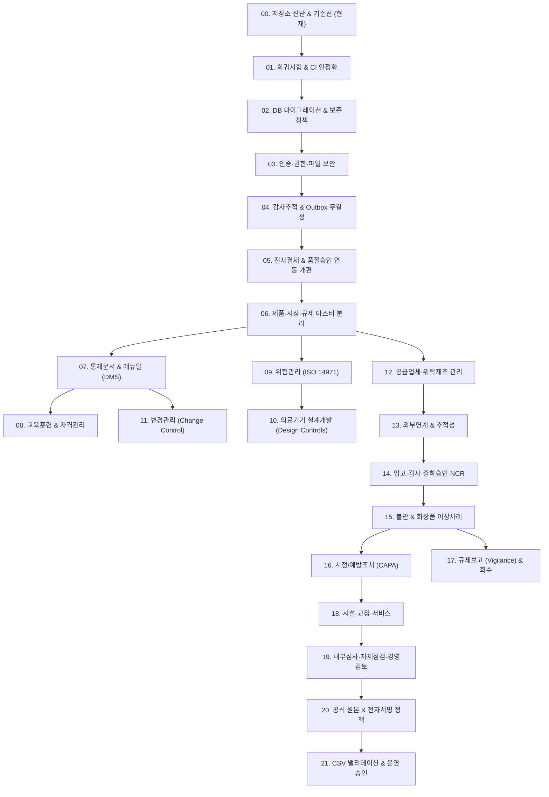

# 🗺️ 통합 eQMS 단계별 구현 로드맵 (implementation-roadmap.md)

> **진행 원칙**: 4단계 게이트(설계 A → 백엔드/DB B → 프론트 C → 검증 D), 단계별 의존성 준수, 사용자 승인 후 다음 단계 착수

---

## 단계별 의존성 다이어그램

---

## 1. 단계별 실행 단위 및 상세 계획

### [00단계] 저장소 진단 및 기준선 수립 (COMPLETED)
- 산출물: `architecture-current.md`, `baseline-results.md`, `eqms-gap-analysis.md`, `decision-register.md`, `implementation-roadmap.md`
- 게이트: 진단 결과 보고 및 사용자 승인 대기.

### [01단계] 회귀시험 및 CI 안정화 (NEXT)
- **목표**: 기존 핵심 기능의 특성화 시험 확보 및 결함 재현 테스트 작성.
- **세부 작업**:
  - PostgreSQL Testcontainer 또는 CI용 테스트 DB 환경 정비.
  - 로그인, 세션 유지, 결재 상신/승인/반려, 클레임, 입고 기본 회귀 테스트 보강.
  - 프론트엔드 빌드 및 핵심 렌더링 회귀 방어.
- **승인 요건**: 모든 회귀 테스트 통과 및 결함 재현 성공.

### [02단계] DB 마이그레이션 및 보존 정책
- **목표**: Flyway 마이그레이션 정책 정렬 및 보존/아카이빙 설계.
- **세부 작업**:
  - `validate-on-migrate` 검증 복원 검토.
  - 신규 마이그레이션 스크립트 불변성 보장 및 H2/PostgreSQL 교차 호환 SQL 작성.
  - 감사로그 물리 삭제 제거 및 장기 보존 파티셔닝/아카이빙 체계 구축.

### [03단계] 인증·권한·파일 보안 강화
- **목표**: CSRF 취약점 보완, 첨부파일 인가 통제.
- **세부 작업**:
  - `/api/**` CSRF 필터 적용 및 CookieCsrfTokenRepository - Axios 연동.
  - `/uploads/**` 익명 접근 차단 및 세션/권한 기반 다운로드 엔드포인트 전환.
  - CORS 허용 오리진 명시적 화이트리스트화.

### [04단계] 감사추적(Audit Trail) 무결성 확보
- **목표**: 트랜잭션 분리로 인한 감사로그 유실 차단.
- **세부 작업**:
  - Transactional Outbox 또는 메인 트랜잭션 동기 커밋 방식으로 핵심 규제 기록 감사로그 전환.
  - 스냅샷 덮어쓰기 복원(`restoreFromLog`) 폐지 및 승인된 정정(Revision/Correction) 방식 적용.

### [05단계] 전자결재 및 품질승인 연동 개편
- **목표**: 결재 승인에 의한 무조건 적합/종결 로직 제거.
- **세부 작업**:
  - `MARKET_RELEASE` 시 실제 검사 결과 적합 여부 선행 검증 로직 추가.
  - `CLAIM_REPORT` 시 조사/안전성 평가 완료 여부 검증 후 종결 분기.
  - 사후 연동 훅 실패 시 트랜잭션 롤백 또는 정밀 오류 통보.

### [06단계 ~ 21단계] 도메인 모듈 순차 확장
- 06단계: 화장품 / 의료기기 제품 마스터 분리
- 07단계: 통제문서 및 개정관리 (DMS)
- 08단계: 교육훈련 및 자격관리
- 09~10단계: 위험관리 (ISO 14971) & 의료기기 설계개발 (Design Controls)
- 11~12단계: 변경관리 & 공급업체 평가
- 13~14단계: 입고/검사/출하승인 & NCR
- 15~17단계: 불만/이상사례, CAPA, 규제보고 & 회수
- 18~21단계: 내부심사, 전자서명, 통합 CSV 밸리데이션
